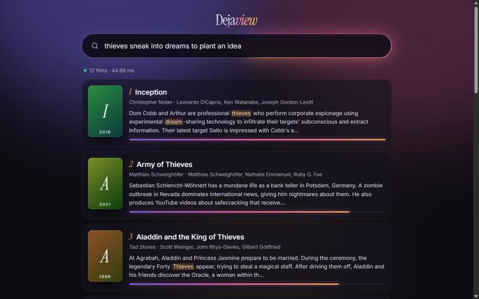
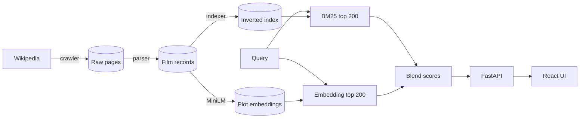

# Dejaview

**Find the film you half remember.** Describe a scene, a character or the ending in your own words, and Dejaview finds the film, even when your description shares no words with the plot.

**Project site:** [soham286.github.io/dejaview](https://soham286.github.io/dejaview/)



Dejaview is a search engine built from scratch: its own web crawler, parser, inverted index and BM25 ranking, with a machine-learning re-ranker that understands meaning, not just matching words. It searches 12,543 American films from 1970 to 2025.

## Results

Measured on 50 vague descriptions of known films ([queries](eval/queries.json), [full results](eval/results.md)):

| Ranking | Right film 1st | In top 3 | In top 10 | MRR |
|---|---|---|---|---|
| Keywords only (BM25) | 54% | 64% | 84% | 0.625 |
| **Smart search (BM25 + embeddings)** | **66%** | **72%** | **90%** | **0.720** |
| Embeddings only | 30% | 50% | 68% | 0.420 |

Blending meaning into keyword search puts the right film first 12 percentage points more often, at a median of 30 ms per query on a laptop CPU. Neither signal is enough alone: embeddings by themselves do worst of all.

MRR (mean reciprocal rank) scores 1 when the right film comes first, 1/2 when second, and so on.

## How it works



1. **Crawler** ([crawl.py](dejaview/crawler/crawl.py)) starts from Wikipedia's yearly film lists and follows each film link. It obeys `robots.txt`, waits a second between requests, backs off when rate-limited, and can resume an interrupted crawl.
2. **Parser** ([parse.py](dejaview/parser/parse.py)) extracts title, year, director, cast, opening paragraphs and plot from each article. Pages without a "Directed by" row are rejected as non-films.
3. **Indexer** ([inverted.py](dejaview/index/inverted.py)) tokenizes text (lowercasing, accent folding, stopwords, plural stripping) and stores a packed postings list per term.
4. **BM25** ([bm25.py](dejaview/ranking/bm25.py)) scores films so that rare words count for more and long articles don't win by length alone.
5. **Re-ranker** ([reranker.py](dejaview/ranking/reranker.py)) embeds every plot in 120-word passages with [all-MiniLM-L6-v2](https://huggingface.co/sentence-transformers/all-MiniLM-L6-v2). Candidates come from BM25 *and* embedding similarity, so a description with no shared words can still be found. Final score: 40% keyword match, 60% meaning.
6. **API** ([app.py](dejaview/api/app.py)) serves `/search` (with `mode=smart` or `mode=keyword`) and `/film/{id}`. It falls back to keyword search if embeddings are missing or out of date.
7. **UI** ([web/](web/)) searches as you type, highlights matched words and keeps the query in the URL so results can be shared.

The crawler, index format, tokenizer and ranking are written by hand, with no search libraries. SQLite is used only as storage.

## Tech stack

| Layer | Technology |
|---|---|
| Search core | Python 3.12, standard library, SQLite |
| Machine learning | sentence-transformers (MiniLM), NumPy, PyTorch (CPU) |
| API | FastAPI, Uvicorn |
| Frontend | React 19, Vite, plain CSS |
| Tooling | uv, pytest, npm |

## Getting started

You need [uv](https://docs.astral.sh/uv/), a recent Node.js (developed on Node 24), and about 1 GB of disk for data.

```bash
git clone https://github.com/Soham286/dejaview.git
cd dejaview
uv sync
npm install --prefix web
```

### Build the data

The crawled data is not in the repository, so build it once. Each step can be rerun on its own.

| Step | Command | Time on a laptop |
|---|---|---|
| Crawl Wikipedia | `uv run python -m dejaview.crawler.crawl` | about 5 hours |
| Parse films | `uv run python -m dejaview.parser.parse` | about 85 minutes |
| Build the index | `uv run python -m dejaview.index.inverted` | under a minute |
| Embed plots | `uv run python -m dejaview.ranking.reranker --build` | about 3 hours on CPU |

For a quick trial, crawl a few years with `--from 2020 --to 2022`. Without embeddings, search runs in keyword mode.

### Run it

Start the API, then the UI in a second terminal, and open http://localhost:5173.

```bash
uv run python -m uvicorn dejaview.api.app:app
```

```bash
npm run dev --prefix web
```

Interactive API docs are at http://127.0.0.1:8000/docs.

## Testing and evaluation

```bash
uv run python -m pytest
```

The 38 tests cover the crawler, parser, index, BM25, re-ranker, API and evaluation metrics. They run offline in seconds: the re-ranker tests use a small stand-in model instead of downloading MiniLM.

```bash
uv run python -m eval.evaluate
```

This scores keyword and smart search on the 50 evaluation queries at six blend weights and rewrites [eval/results.md](eval/results.md).

On some Windows machines, Application Control blocks the `pytest.exe` launcher, which is why the commands above go through `python -m`.

## Project structure

```
dejaview/
├── crawler/    Wikipedia crawler
├── parser/     HTML to film records
├── index/      tokenizer and inverted index
├── ranking/    BM25 and the embedding re-ranker
└── api/        FastAPI service
eval/           evaluation queries, script and results
tests/          unit and integration tests
web/            React frontend
```

## Limitations

- **Evaluation bias.** The blend weight was tuned on the same 50 queries it is reported on, and the queries were written by people who knew the plots. A held-out set written by others would give a fairer number.
- **Title matches.** Titles are weighted three times in the index, so a query word that appears in a title (for example "weatherman" and *The Weather Man*) can outrank the right film. This causes most remaining misses.
- **Coverage.** Only American films listed on Wikipedia, so foreign films are missing.
- **Duplicates.** 17 films appear twice because the crawler does not resolve Wikipedia redirects.
- **Speed of building.** Embedding runs on CPU and takes hours; a GPU would cut this to minutes.

## Roadmap

- [ ] Lower the title weight and re-evaluate
- [ ] Held-out evaluation set written by other people
- [ ] Compare toggle and "why this result" panel in the UI
- [ ] Real posters from TMDB
- [ ] Continuous integration and Docker
- [ ] Resolve redirects to remove duplicate films

## Data and attribution

Film text comes from [Wikipedia](https://en.wikipedia.org/) and is available under [CC BY-SA 4.0](https://creativecommons.org/licenses/by-sa/4.0/). The embedding model is [all-MiniLM-L6-v2](https://huggingface.co/sentence-transformers/all-MiniLM-L6-v2) (Apache 2.0).
